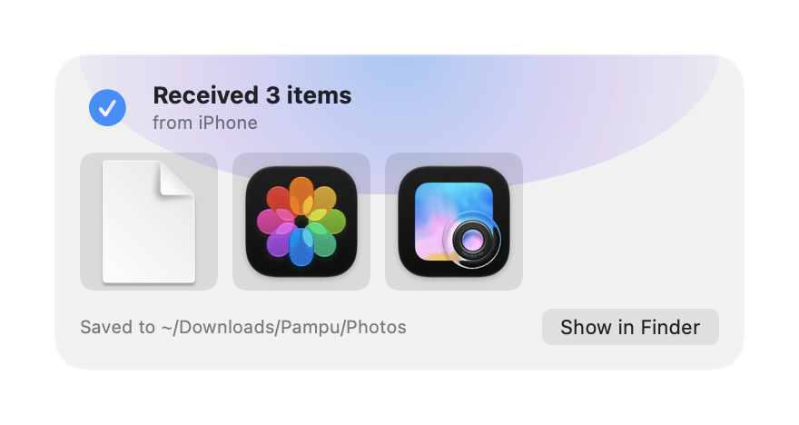
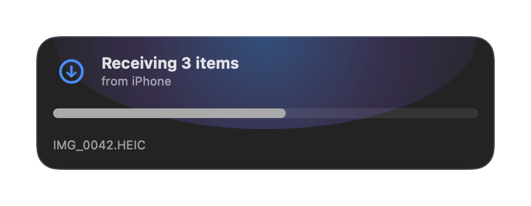
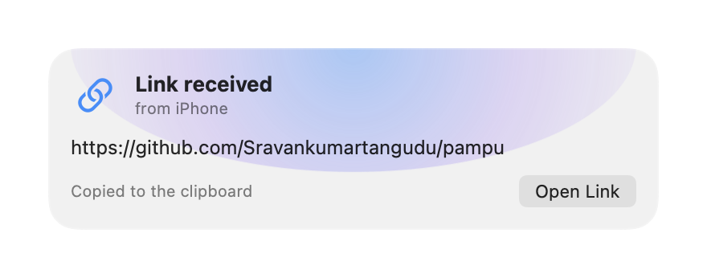
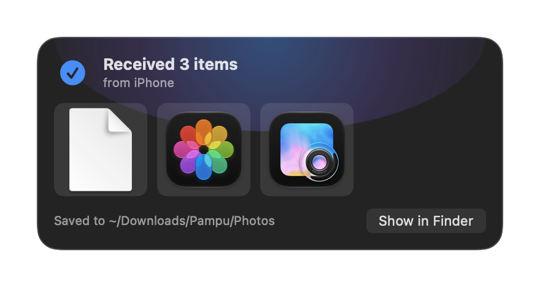

<div align="center">


# Pampu

**NameDrop for your Mac. Bring your iPhone close and your photos, files and links drop onto it.**

Pick what you want on the iPhone, hold the top of the iPhone near your Mac, and it lands in
`~/Downloads/Pampu`. The iPhone buzzes and a glow rolls down its screen. On the Mac, a panel
drops in under the menu bar with the progress, then thumbnails with **Open** and **Show in Finder**.
It works without a shared network, so office and guest Wi-Fi are fine.

*Pampu (పంపు) means "send" in Telugu.*



</div>

---

## What it does

| | |
|---|---|
| **Bring it close, it drops** | Pampu on the Mac sends out a small Bluetooth signal. The iPhone measures how strong it is, and once it's close for two readings in a row, everything waiting goes. Choose **Touching**, **Close** or **Nearby** in Settings, with a live reading to help. |
| **Or tap Send** | **Send Now** works at any distance in range, and when Bluetooth is off. Turn off *Send when brought close* if you'd rather always tap. |
| **From anywhere on the iPhone** | In the app: **Photos**, **Files** or **Paste**. From any other app: **Share › Pampu** (Photos, Files, Safari, Notes…). Up to 50 items at once. |
| **No Wi-Fi needed** | A direct, encrypted peer-to-peer link (Apple's MultipeerConnectivity, over peer-to-peer Wi-Fi and Bluetooth). Nothing goes through a server or a cloud, and you don't need an account. |
| **Pair once** | The first time, the iPhone shows a code and the Mac asks you, showing the same code. After that the Mac checks the iPhone's secret on every connection. |
| **Sorted for you** | Into **Photos**, **Screenshots**, **Videos**, **Audio**, **Documents**, **Archives** and **Other** (you can turn this off). Names never overwrite. Links and text go to the clipboard, and links can open by themselves if you like. |
| **Photos your way** | Originals (HEIC, full quality) or most-compatible JPEG. |
| **Several Macs** | Pick which one from the list on the iPhone. It remembers the last one you sent to. |

<table>
<tr>
<td></td>
<td></td>
</tr>
<tr>
<td align="center">The iPhone is close</td>
<td align="center">Receiving (Dark Mode)</td>
</tr>
<tr>
<td></td>
<td></td>
</tr>
<tr>
<td align="center">A link, copied to the clipboard</td>
<td align="center">Done (Dark Mode)</td>
</tr>
</table>

---

## Install

You need both halves: the Mac app and the iPhone app.

### Mac (macOS 14 or later)

1. Download **Pampu.dmg** from the [latest release](https://github.com/Sravankumartangudu/pampu/releases/latest).
2. Open it and drag **Pampu** into **Applications**.
3. Open it. The app isn't notarised, so the first time macOS may block it: open
   **System Settings → Privacy & Security** and click **Open Anyway**.
4. Allow **Bluetooth** and **Local Network** when macOS asks. Look for **🪂** in the menu bar.

### iPhone (iOS 17 or later)

There's no App Store version. You build it onto your own iPhone with Xcode, which is free with
any Apple ID:

1. Clone this repo and open `iPhone/Pampu.xcodeproj` in Xcode.
2. **Xcode › Settings › Accounts**: add your Apple ID.
3. Select the **Pampu** target › **Signing & Capabilities**, pick your team, and do the same for
   **PampuShare**. If Xcode says the bundle ID is taken, change `com.stangudu.pampuphone` (and
   `.share`) to something of your own.
4. Plug in your iPhone, pick it as the run destination and press **Run**. The first time, turn on
   **Settings › Privacy & Security › Developer Mode** on the iPhone, then trust your developer
   profile in **Settings › General › VPN & Device Management**.
5. Open Pampu on the iPhone and allow **Bluetooth** and **Local Network**.

> [!NOTE]
> With a free Apple ID, apps you build expire after 7 days. Press **Run** in Xcode again to
> renew it. Your pairing is kept.

Or from Terminal, with the iPhone's id from `xcrun devicectl list devices`:

```sh
cd iPhone
xcodebuild -scheme Pampu -destination 'id=<iPhone id>' -derivedDataPath build -allowProvisioningUpdates build
xcrun devicectl device install app --device <iPhone id> build/Build/Products/Debug-iphoneos/Pampu.app
```

---

## Use

1. **Pair.** Open Pampu on both. The iPhone finds the Mac by itself. Tap **Pair with …**, check the
   code matches on both screens, and click **Allow** on the Mac.
2. **Pick.** Photos, Files or Paste in the app, or **Share › Pampu** from any app.
3. **Drop.** Hold the top of the iPhone near the Mac's keyboard or screen. Or tap **Send Now**.

The 🪂 menu on the Mac:

| | |
|---|---|
| **Receiving** | Uncheck it and the Mac stops being visible to iPhones. |
| **Recent Drops** | The last 15 drops; pick one to show it in Finder. |
| **Open Drop Folder / Change Drop Folder…** | `~/Downloads/Pampu` by default. |
| **Sort Into Folders by Type** · **Open Links Automatically** · **Play Sounds** | On, off, on by default. |
| **Paired iPhones** | Forget one, or all. A forgotten iPhone has to pair again. |
| **Appearance** | System, Light or Dark. |
| **Launch at Login** | Start Pampu when you log in. |

The iPhone's **Settings** has its name (as the Mac shows it), *Send when brought close*, how
close, photo format, Appearance, and paired Macs.

### If the drop doesn't start by itself

- Check the signal bars on the iPhone. If they never fill up, pick **Nearby** in Settings. If it
  drops too early, pick **Touching**.
- The Bluetooth antenna is in a different place on each Mac model; try the keyboard and the top of
  the screen.
- **Send Now** always works while the iPhone says *Connected*.

---

## How it works

```
iPhone                                              Mac
──────                                              ───
MCNearbyServiceBrowser  ── finds _pampu-drop ──▶   MCNearbyServiceAdvertiser
                        ◀── encrypted MCSession ──▶
                        ◀── hello {mac id, nonce}
auth {HMAC(secret, id|nonce)} ──────────────────▶   checks it (constant time)  → ok
  or pair {code} ───────────────────────────────▶   asks you → paired {secret}
CBCentralManager        ◀── BLE advert (RSSI) ───   CBPeripheralManager
  close?  ── near / batch / files / text ──────▶   DropPanel + ~/Downloads/Pampu/<type>/
```

| Folder | |
|---|---|
| `mac/` | The menu-bar app: receiver, Bluetooth beacon, drop panel, filing, pairing store. Built with `swiftc` by `build.sh`. |
| `iPhone/Phone/` | The iPhone app. |
| `iPhone/Share/` | The Share extension. It sends by itself, so it doesn't need the app to be open. |
| `iPhone/PhoneShared/` | Shared by both: sender, closeness, tray and the drop screen. |
| `Shared/Wire.swift` | The message format and the pairing proof, compiled into all three. |

## Build from source

```sh
./build.sh             # build/Pampu.app (universal)
./build.sh --install   # build, put it in ~/Applications and open it
./build.sh --dist      # also build/Pampu.dmg and build/Pampu.zip
open build/Pampu.app --args --demo   # play the panel's states without a phone
scripts/screenshots.sh # redraw docs/screenshots
```

Mac: Xcode command-line tools, macOS 14 SDK or later. iPhone: Xcode 15 or later.

---

[Security](SECURITY.md) · [Changelog](CHANGELOG.md) · [MIT License](LICENSE)
