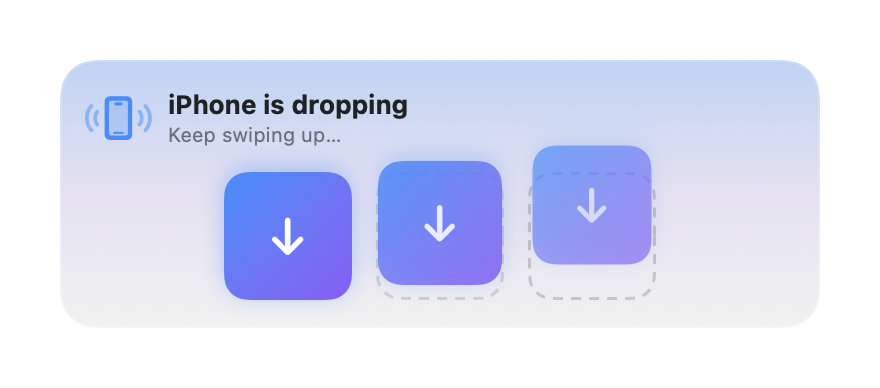
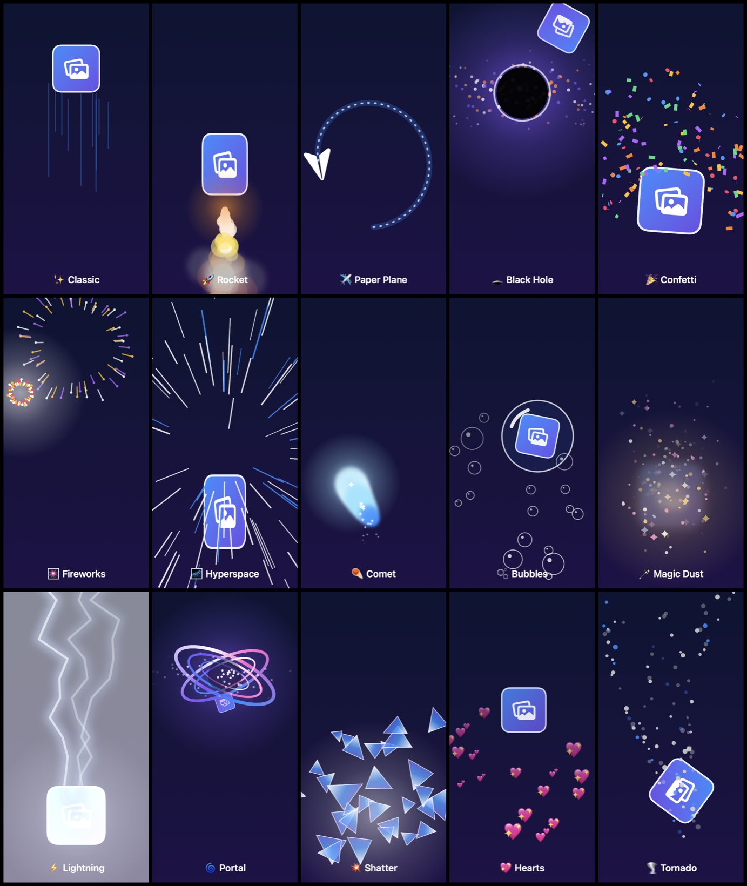
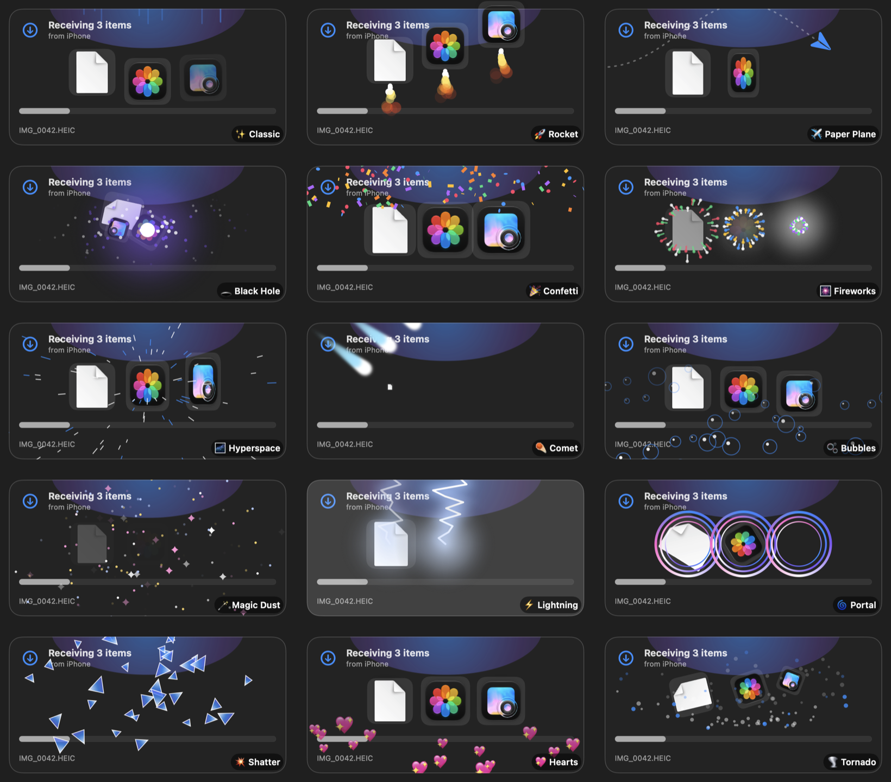

<div align="center">


# Pampu

**NameDrop for your Mac. Bring your iPhone close, swipe up, and your photos, files and links slide onto it.**

Pick what you want on the iPhone and hold the top of it near your Mac. Both react: the iPhone buzzes
and glows, and a panel slides down out of the Mac's menu bar with empty slots. Swipe the stack up on
the iPhone and cards follow your finger into the Mac's slots; let go and the stack flies off the top
of the iPhone while its thumbnails slide in on the Mac. Everything lands in `~/Downloads/Pampu`,
with **Open** and **Show in Finder**.
It works without a shared network, so office and guest Wi-Fi are fine.

*Pampu (పంపు) means "send" in Telugu.*


</div>

---

## What it does

| | |
|---|---|
| **Bring it close, swipe up** | Pampu on the Mac sends out a small Bluetooth signal and the iPhone measures how strong it is. Once it's close, both glow and the stack lifts. Swipe it up: the Mac's cards follow your swipe live, and a tick tells you when letting go will drop it. Choose **Touching**, **Close** or **Nearby** in Settings, with a live reading to help. |
| **Or let it drop by itself** | Pick **Drop Right Away** in Settings and it goes as soon as the iPhone is close. Swiping up and **Send Now** also work at any distance in range, and with Bluetooth off. |
| **15 drop effects** | 🚀 Rocket, ✈️ Paper Plane, 🕳️ Black Hole, 🎆 Fireworks, ⚡ Lightning, 🌀 Portal and more. The iPhone throws the stack with its own particles and haptics, and the Mac plays the matching landing. Pick one in **Settings › Drop effect** (with a live preview), or **🎲 Random** for a different one every time. |
| **Swipe it away on the Mac** | Swipe up on the panel with two fingers, or drag it up, to put it away. Mid-drop it stays out of the way and comes back when everything has landed. |
| **From anywhere on the iPhone** | In the app: **Photos**, **Files** or **Paste**. From any other app: **Share › Pampu** (Photos, Files, Safari, Notes…). Up to 50 items at once. |
| **No Wi-Fi needed** | A direct, encrypted peer-to-peer link (Apple's MultipeerConnectivity, over peer-to-peer Wi-Fi and Bluetooth). Nothing goes through a server or a cloud, and you don't need an account. |
| **Pair once** | The first time, the iPhone shows a code and the Mac asks you, showing the same code. After that the Mac checks the iPhone's secret on every connection. |
| **Sorted for you** | Into **Photos**, **Screenshots**, **Videos**, **Audio**, **Documents**, **Archives** and **Other** (you can turn this off). Names never overwrite. Links and text go to the clipboard, and links can open by themselves if you like. |
| **Photos your way** | Originals (HEIC, full quality) or most-compatible JPEG. |
| **Several Macs** | Pick which one from the list on the iPhone. It remembers the last one you sent to. |

<table>
<tr>
<td></td>
<td></td>
</tr>
<tr>
<td align="center">The iPhone is close</td>
<td align="center">Swiping up on the iPhone</td>
</tr>
<tr>
<td></td>
<td></td>
</tr>
<tr>
<td align="center">Let go: the thumbnails slide in (Dark Mode)</td>
<td align="center">Done</td>
</tr>
<tr>
<td></td>
<td></td>
</tr>
<tr>
<td align="center">A link, copied to the clipboard</td>
<td align="center">Done (Dark Mode)</td>
</tr>
</table>

### Drop effects

Pick one in **Settings › Drop effect** on the iPhone, or **🎲 Random** (the default) for a new one every drop.



The Mac plays the matching landing as the cards arrive:



---

## Install

You need both halves: the Mac app and the iPhone app.

### Mac (macOS 14 or later)

1. Download **Pampu.dmg** from the [latest release](https://github.com/Sravankumartangudu/pampu/releases/latest).
2. Open it and drag **Pampu** into **Applications**.
3. Open it. The app isn't notarised, so the first time macOS may block it: open
   **System Settings → Privacy & Security** and click **Open Anyway**.
4. Allow **Bluetooth** and **Local Network** when macOS asks. Look for **🪂** in the menu bar.

### iPhone (iOS 17 or later)

There's no App Store version. You build it onto your own iPhone with Xcode, which is free with
any Apple ID:

1. Clone this repo and open `iPhone/Pampu.xcodeproj` in Xcode.
2. **Xcode › Settings › Accounts**: add your Apple ID.
3. Select the **Pampu** target › **Signing & Capabilities**, pick your team, and do the same for
   **PampuShare**. If Xcode says the bundle ID is taken, change `com.stangudu.pampuphone` (and
   `.share`) to something of your own.
4. Plug in your iPhone, pick it as the run destination and press **Run**. The first time, turn on
   **Settings › Privacy & Security › Developer Mode** on the iPhone, then trust your developer
   profile in **Settings › General › VPN & Device Management**.
5. Open Pampu on the iPhone and allow **Bluetooth** and **Local Network**.

> [!NOTE]
> With a free Apple ID, apps you build expire after 7 days. Press **Run** in Xcode again to
> renew it. Your pairing is kept.

Or from Terminal, with the iPhone's id from `xcrun devicectl list devices`:

```sh
cd iPhone
xcodebuild -scheme Pampu -destination 'id=<iPhone id>' -derivedDataPath build -allowProvisioningUpdates build
xcrun devicectl device install app --device <iPhone id> build/Build/Products/Debug-iphoneos/Pampu.app
```

---

## Use

1. **Pair.** Open Pampu on both. The iPhone finds the Mac by itself. Tap **Pair with …**, check the
   code matches on both screens, and click **Allow** on the Mac.
2. **Pick.** Photos, Files or Paste in the app, or **Share › Pampu** from any app.
3. **Drop.** Hold the top of the iPhone near the Mac's keyboard or screen. When both glow, swipe
   the stack up and let go. Or tap **Send Now**.

The 🪂 menu on the Mac:

| | |
|---|---|
| **Receiving** | Uncheck it and the Mac stops being visible to iPhones. |
| **Recent Drops** | The last 15 drops; pick one to show it in Finder. |
| **Open Drop Folder / Change Drop Folder…** | `~/Downloads/Pampu` by default. |
| **Sort Into Folders by Type** · **Open Links Automatically** · **Play Sounds** | On, off, on by default. |
| **Paired iPhones** | Forget one, or all. A forgotten iPhone has to pair again. |
| **Landing Effect** | *Same as the iPhone*, 🎲 Random, or always one of the 15. Picking one plays it. |
| **Appearance** | System, Light or Dark. |
| **Launch at Login** | Start Pampu when you log in. |

The iPhone's **Settings** has its name (as the Mac shows it), what bringing it close does
(**Swipe Up** or **Drop Right Away**), the **Drop effect**, how close, photo format, Appearance, and paired Macs.

### If they don't glow

- Check the signal bars on the iPhone. If they never fill up, pick **Nearby** in Settings. If the
  glow comes too early, pick **Touching**.
- You don't have to wait for the glow: swiping up works from anywhere in range.
- The Bluetooth antenna is in a different place on each Mac model; try the keyboard and the top of
  the screen.
- Swiping up and **Send Now** always work while the iPhone says *Connected*.

---

## How it works

```
iPhone                                              Mac
──────                                              ───
MCNearbyServiceBrowser  ── finds _pampu-drop ──▶   MCNearbyServiceAdvertiser
                        ◀── encrypted MCSession ──▶
                        ◀── hello {mac id, nonce}
auth {HMAC(secret, id|nonce)} ──────────────────▶   checks it (constant time)  → ok
  or pair {code} ───────────────────────────────▶   asks you → paired {secret}
CBCentralManager        ◀── BLE advert (RSSI) ───   CBPeripheralManager
  close?  ── near ─────────────────────────────▶   panel slides down, empty slots
  swipe   ── pull {0…1} (live) ────────────────▶   cards follow into the slots
  let go  ── fling {thumbs, effect} / text ─────▶   the matching landing plays
          ── one resource per file ────────────▶   ~/Downloads/Pampu/<type>/
```

| Folder | |
|---|---|
| `mac/` | The menu-bar app: receiver, Bluetooth beacon, drop panel, filing, pairing store. Built with `swiftc` by `build.sh`. |
| `iPhone/Phone/` | The iPhone app. |
| `iPhone/Share/` | The Share extension. It sends by itself, so it doesn't need the app to be open. |
| `iPhone/PhoneShared/` | Shared by both: sender, closeness, tray and the drop screen. |
| `Shared/Wire.swift` | The message format and the pairing proof, compiled into all three. |
| `Shared/Effects.swift` | The 15 drop effects: how the stack moves and the particles drawn, for both the throw and the landing. |

## Build from source

```sh
./build.sh             # build/Pampu.app (universal)
./build.sh --install   # build, put it in ~/Applications and open it
./build.sh --dist      # also build/Pampu.dmg and build/Pampu.zip
open build/Pampu.app --args --demo   # play the panel (close, swipe, throw, done) without a phone
open build/Pampu.app --args --demo rocket   # play one landing effect
scripts/screenshots.sh # redraw docs/screenshots
scripts/effects.sh     # draw every effect (docs/screenshots/effects-*.png, frames/ to check by eye)
```

Mac: Xcode command-line tools, macOS 14 SDK or later. iPhone: Xcode 15 or later.

---

[Security](SECURITY.md) · [Changelog](CHANGELOG.md) · [MIT License](LICENSE)
